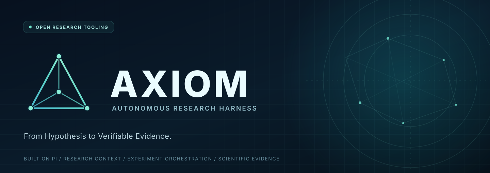

<div align="center">



<br />

**Autonomous eXperimentation & Intelligent Orchestration for Machine Learning**

基于 Pi Agent 的科研实验自动化与可信证据 Harness

[](https://github.com/earendil-works/pi)


</div>

> **项目阶段：初始化 / Design & Bootstrap**
>
> AXIOM 目前正在搭建基础架构。下文的业务能力是**开发目标**，不是已经完成的功能；请以仓库中的代码、测试与里程碑为准。

## 🎯 项目介绍

AXIOM 面向需要反复训练、评估、复现实验的 AI / ML 研究者，目标是将科研流程从自然语言想法连接到**可追溯的实验记录**，再连接到**可核验的论文结果**。

它不是又一个文献问答机器人，也不是简单地把大模型接到 MLflow。AXIOM 的重点是开发面向科研业务的 **Agent Harness**：

- **实验规划**：读取研究目标、训练配置与现有结果，提出下一步实验方案。
- **可信数据管理**：将指标关联到评估产物、模型权重、配置、数据集版本与 Git Commit；缺失证据时明确标注。
- **GPU 任务执行**：在获得用户批准后，提交并监控本地或远程训练/评估任务。
- **可靠恢复**：区分 Agent 会话与真实训练任务，避免任务中断后重复启动高成本实验。
- **结果与论文协作**：从经过核验的实验结果生成对比表和论文分析草稿，并保留来源。

## 🧭 首个落地场景：私有科研实验工作区

第一阶段先从用户本地的私有机器学习实验工作区入手（不公开其研究名称、论文内容和原始数据），完成：

1. 导入实验配置、日志、评估输出和已有实验记录；
2. 从原始文件提取指标、建立指标与来源之间的关联；
3. 检查不同 Run 的数据集、评估口径、代码版本、随机种子等是否具有可比性；
4. 支持自然语言查询实验差异与缺失的消融实验；
5. 导出标注来源的 Markdown / CSV / LaTeX 实验对比表。

**重要原则：**不能凭模型输出虚构实验指标、GPU 耗时、论文引用或训练结果；未被验证的记录必须标记为未验证。

## 🏗️ 计划架构

```text
Web / CLI
   │
   ▼
AXIOM API
   │
   ├── Research Context Engine   # 科研上下文组装
   ├── Experiment Registry       # 实验实体与追溯关系
   ├── Scientific Evidence       # 证据与指标一致性校验
   ├── Workflow / Approval       # 任务状态和人工审批
   └── Evaluation & Trace        # 执行过程与业务评测
   │
   ▼
Pi Agent SDK + Extensions + Skills + MCP
   │
   ├── Git / Config / Log Adapters
   ├── MLflow Adapter
   └── Python GPU Runner (未来阶段)
```

### 分层与开发边界

| 层 | 方案 | AXIOM 的工作 |
| --- | --- | --- |
| Agent Loop / 模型 / 工具 | Pi SDK | **复用**，不重写基础循环 |
| Sessions / Compaction / Skills / MCP | Pi | **复用并配置** |
| Research Context / Evidence | TypeScript | **重点自研** |
| 实验跟踪 | MLflow（可选集成） | 使用成熟组件 + 业务适配 |
| GPU 训练与状态恢复 | Python Runner | **重点自研** |
| 前端 | React（规划） | 按 MVP 需要逐步添加 |

## 🗂️ 计划目录

```text
AXIOM/
├── README.md
├── docs/                       # 架构、业务规范、开发计划
├── apps/
│   ├── api/                    # 未来的 TypeScript API
│   └── web/                    # 未来的科研控制台
├── packages/
│   ├── agent/                  # Pi SDK 适配层
│   ├── harness/                # 上下文 / 证据 / 编排 / 审批
│   └── research-tools/         # 科研领域工具
├── services/
│   └── experiment-runner/      # 未来的 Python GPU Runner
├── evals/                      # 业务与 Harness 评测
├── examples/
│   └── synthetic-experiment/   # 使用合成数据的公开示例
└── vendor/
    └── pi/                     # Pi 官方源码（Git submodule，固定上游提交）
```

目录结构是目标结构，目前 `vendor/pi` 已作为 Git submodule 接入；其他尚未创建的模块不代表已实现。

架构设计说明：[docs/ARCHITECTURE.md](./docs/ARCHITECTURE.md)。公开示例只使用合成数据，不包含未发表论文的研究名称、真实实验结果或私有代码。

## 🛠️ 初步技术选型

- **Agent**：[`@earendil-works/pi-coding-agent`](https://github.com/earendil-works/pi/tree/main/packages/coding-agent) / Pi TypeScript SDK
- **主服务**：Node.js 22.19+、TypeScript
- **科研执行**：Python、PyTorch、SSH / Runner API（后续）
- **实验记录**：PostgreSQL / SQLite、MLflow（随实现阶段评估）
- **交互**：CLI 优先，随后 React Web
- **扩展能力**：Pi Extensions、Skills、MCP
- **质量**：Vitest / pytest、固定实验任务集、来源追溯与回归测试

## ✅ 开发路线

- [ ] **MVP 0**：接入 Pi SDK，完成本地对话与自定义科研工具示例
- [ ] **MVP 1**：实验文件导入、结构化 Run Registry、指标来源追溯
- [ ] **MVP 2**：科研 Context Engine、配置可比性校验、实验对比表
- [ ] **Phase 2**：MLflow 集成、实验计划、执行审批
- [ ] **Phase 3**：远程 GPU Runner、任务去重、监控与失败恢复
- [ ] **Phase 4**：论文结果关联、Web 控制台、业务 Evals
- [ ] **探索**：Pi Durable、多 Agent 与其他进阶能力（以实际收益为依据）

## 🔒 安全与科研严谨性

- 本地日志、数据集、模型权重、未发表论文内容与 API Key 默认不提交公开仓库；详见 `.gitignore`。
- 提交训练、删除产物、终止任务等高成本或不可逆操作必须有明确授权。
- 真实 GPU 任务由独立 Runner 管理，Agent 会话退出不应导致运行状态丢失。
- 所有论文结果来自可追溯的实际评估文件，不能由模型编造。
- 本项目不声称已经达到无人值守的科研自动化。

## 🌱 Pi 上游源码

本项目以 [Pi](https://github.com/earendil-works/pi) 为 Agent 基础。已将 Pi 官方仓库以 **Git submodule** 接入 `vendor/pi/`，固定上游提交 `676af1d777ef6f04b6bc8daf4cf3b9b1799cff4d`。首次克隆使用 `git clone --recurse-submodules https://github.com/luming9494/AXIOM.git`，已有本地副本使用 `git submodule update --init --recursive` 拉取完整源码。更新上游时需单独审查 Pi 变更并提交新的子模块指针。

上游由其原作者及贡献者维护，遵循 [MIT License](https://github.com/earendil-works/pi/blob/main/LICENSE)。引用及再分发时保留原始版权与许可说明。AXIOM 本身与 Pi 官方项目无隶属关系。

Pi SDK 适配开发时，可以阅读 [Pi SDK 文档](https://github.com/earendil-works/pi/blob/main/packages/coding-agent/docs/sdk.md) 和 [Pi Extensions 文档](https://github.com/earendil-works/pi/blob/main/packages/coding-agent/docs/extensions.md)。

---

**AXIOM · Autonomous Research Harness · Built on Pi**
