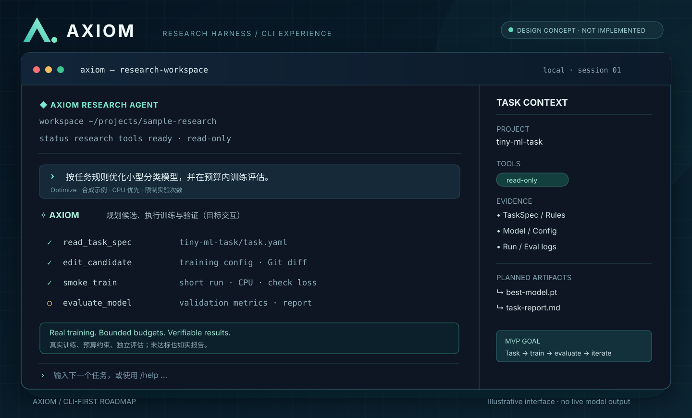

# AXIOM CLI-first 开发计划

> **项目**：AXIOM · Autonomous Research Harness  
> **版本**：v0.2 规划稿（2026-11-05）  
> **实施原则**：CLI-first / 基于 Pi 扩展 / 科研证据优先 / 先真实可用，后丰富界面  
> **公开仓库**：[luming9494/AXIOM](https://github.com/luming9494/AXIOM)

## 0. 未来 AXIOM CLI 长什么样？



> **注意：这是一张交互设计概念图，不是当前 CLI 的实际运行截图。** 图里的会话界面、工具步骤和产物侧栏属于目标体验；现阶段仓库里的 `ask` 仍为单次快照问答入口，并没有完整的交互式科研 Agent 工作台。

### CLI 产品原则

- **像 Pi / Codex 一样以任务为中心**：打开项目就能输入自然语言任务，模型能在任务内读取真实证据、调用科研工具。
- **先复用 Pi 原生 TUI**：不急于重写终端渲染、输入框、滚动和模型选择，优先通过 Pi Extensions / Skills 增加科研能力。
- **普通问答与确定性操作并存**：自然语言负责理解与计划，`import`、`compare`、`verify`、`export` 等业务命令负责可靠执行。
- **过程透明**：展示正在使用的工具、来源路径、验证状态、失败原因和生成产物。
- **默认本地、安全与可复现**：不把 API Key、未发表论文、真实实验日志和权重提交到公共仓库；默认只读，危险操作明确审批。

## 1. 当前进度（依据仓库现有代码）

| 能力 | 当前状态 | 依据 / 下一步 |
| --- | --- | --- |
| Pi 上游源码 | ✅ 已引入 | `vendor/pi` Git submodule；不建议直接修改上游 |
| JSON 实验清单导入 | ✅ 已实现 | `src/research.ts` 与 `src/cli.ts` |
| 指标来源数值校验及 SHA-256 | ✅ 已实现基础版 | `verified` 仅表示值匹配和来源文件记录，**不等于实验真实性审计** |
| Markdown / CSV / LaTeX 导出 | ✅ 已实现 | `src/table.ts` |
| 数据集和评估协议一致性检查 | ✅ 已实现基础版 | 其他配置差异仍需补充检查 |
| Pi SDK 快照问答 | 🟡 已接线、待真实验证 | `src/agent.ts`；需要本地凭据，当前无科研工具 |
| Pi 交互式科研 Agent | ⬜ 未完成 | 实现工具、生命周期与会话交互 |
| GPU 训练与恢复 | ⬜ 未完成 | 后续独立 Runner |
| Web 前端 | 🟡 已有离线预览 | 暂缓扩展，保持现有代码，不作为本轮主线 |

**不重复造轮子**：Pi 已有 Agent Loop、基础工具调用、会话、Compaction、Extensions、Skills 和 MCP 接入能力。AXIOM 重点开发科研上下文、证据验证、实验编排、审批和运行状态一致性。

## 2. 目标范围与非目标

### 近期要交付

1. 在真实本地模型凭据下验证 `ask` 成功、失败、超时和密钥脱敏。
2. 跑通 Pi 交互式终端 + AXIOM 第一个科研 Extension。
3. 通过工具**按需读取**实验注册表和证据，而不是总把完整快照塞进 Prompt。
4. 实现可复用的 `experiment-compare` Skill 和确定性对比工具。
5. 以公开合成实验测试流程，生成带证据状态的报告。

### 暂时不做

- 不继续扩展 React Web，也不先上 Electron / Tauri。
- 不重写 Pi Agent Loop / TUI；先验证扩展接口是否足够。
- 不在最初 MVP 上堆多个 Agent、向量数据库、复杂 RAG 和 Kubernetes。
- 不让模型直接无审批地提交昂贵训练、删除权重或操作远程服务器。
- 不将未发表研究项目名称、私有数据和实验结果放进公开仓库。

## 3. Pi 源码阅读计划（带着问题阅读）

| 优先级 | 文件或文档 | 必须搞清的问题 | 阅读产物 |
| --- | --- | --- | --- |
| P0 | `vendor/pi/packages/agent/src/agent-loop.ts` | 一轮模型推理、Tool Call、工具结果、继续推理是如何连接的？ | 简化调用链笔记 |
| P0 | `vendor/pi/packages/agent/src/agent.ts` | Agent 状态、运行控制、事件订阅如何工作？ | 状态与事件说明 |
| P0 | `vendor/pi/packages/coding-agent/docs/extensions.md` | 自定义工具如何注册、怎样做执行限制？ | 第一个扩展原型 |
| P0 | `vendor/pi/packages/coding-agent/docs/sdk.md` | `createAgentSession`、Session、ModelRuntime、事件流怎么接入？ | SDK 最小可运行例子 |
| P1 | `vendor/pi/packages/coding-agent` 的 Session / Context / Compaction 相关实现 | 会话、压缩和科研证据上下文应该怎样分离？ | Context 设计笔记 |
| P1 | `vendor/pi/packages/coding-agent/docs/skills.md` 与 MCP 文档 | 何时用 Tool、何时用 Skill、何时接 MCP？ | 首个科研 Skill |
| P2 | Pi Durable | 长任务恢复能复用什么、哪些 GPU 状态仍要自研？ | 后续评估记录 |

源码阅读应以 AXIOM **锁定的 Pi 子模块提交和 npm SDK 版本**为准；两者可能不同，必须检查导出类型及实际接口。

**阅读策略**：每读一个模块就回答一个问题，接着写最小验证代码；不要因为“源码没看完”而无限推迟开发。

## 4. 实施路线

### 阶段 A — Pi 基础和 CLI 接入（建议第 1 周）

- [ ] 在本机执行 `npm ci`、`npm run build`、`npm test`。
- [ ] 执行现有 `import` / `export`，确认基础证据链正常。
- [ ] 本地配置模型密钥，运行 `ask`，记录成功与失败轨迹（不提交密钥）。
- [ ] 读通 Agent Loop、SDK 与 Extension 的调用链。
- [ ] 在 `.pi/extensions/` 实现最小科研工具（例如 `research_workspace_info`）。
- [ ] 通过 Pi 原生 CLI/TUI 调用扩展，看到真实的工具执行与结果返回。

**验收**：一条真实的 Agent Tool Call 能读取指定工作区内的**非敏感项目元数据**，返回正确输出；工具失败也有可理解的错误提示。

### 阶段 B — 科研工具与交互工作流（建议第 2–3 周）

- [ ] 将现有 `importRuns` 和 `exportTable` 封装成单独的只读科研工具。
- [ ] 设计 `list_runs`、`get_run`、`compare_runs`、`verify_evidence` 工具契约和输入约束。
- [ ] 避免大快照直接进入上下文；按实验、指标、证据片段检索。
- [ ] 实现首个 `experiment-compare` Skill，明确输入、验证步骤、报告格式。
- [ ] 增加相同工具重复调用限制、输出长度限制和错误处理。
- [ ] 实现终端中的任务过程展示：优先使用 Pi 自带事件/TUI。
- [ ] 对合成实验完成一条端到端任务，生成证据化 Markdown 对比报告。

**验收**：用户输入“对比两次示例实验并解释哪些结论有证据”，Agent 真实调用工具，报告能追溯到来源文件；不把未验证值包装为可信结论。

### 阶段 C — Experiment Harness 深化（建议第 4–5 周）

- [ ] 增加配置差异分析、评估口径及数据集一致性检查。
- [ ] 实现 Research Context Assembler：研究任务、Run、Config、Evidence 的按需装配。
- [ ] 为分析任务记录 `task_id`、工具轨迹、输入摘要、产物路径。
- [ ] 定义 `planned / running / waiting_approval / completed / failed` 状态。
- [ ] 将基础证据核验从“值相等”升级为来源哈希、评估元数据、指标口径等多层检查。
- [ ] 补充失败测试：缺失产物、错误路径、跨目录读取、不同协议、重复 Run、错误模型输出。

**验收**：一个固定合成任务集可重复评估；同样输入得到结构一致的证据表，错误场景能正确失败而不是幻觉补全。

### 阶段 D — 远程 GPU Runner（建议第 6–8 周）

- [ ] Python 独立 Runner：`submit / status / logs / cancel`。
- [ ] 先支持本地模拟长任务，再支持 Windows → Linux SSH。
- [ ] 以 `job_id` 实现幂等提交；重连时先核验远端状态。
- [ ] 管理训练配置、进程状态、日志、Checkpoint 和产物路径。
- [ ] GPU 预算、危险命令和终止任务需经确定性权限策略及人工审批。
- [ ] 覆盖断网、进程崩溃、远端已提交但本地未收到回复等故障。
- [ ] 按实际收益评估 Pi Durable；不能把 Agent 会话恢复误当作 GPU 进程恢复。

**验收**：任务管理器退出后训练任务仍可被重新发现；重复提交不会启动第二份相同付费任务；不批准无法执行有成本或破坏性的动作。

### 阶段 E — 文档、评测和后续界面（阶段性推进）

- [ ] 以纯合成数据和脱敏截图公开演示。
- [ ] 输出工具成功率、任务完成率、证据错误率、资源开销和恢复成功率。
- [ ] 完善 README、模块设计、CLI 使用说明及架构决策记录。
- [ ] CLI 主线稳定后，再决定复用同一 Harness 接 Web / Desktop。

## 5. 推荐仓库结构

```text
AXIOM/
├── README.md
├── docs/
│   ├── ARCHITECTURE.md
│   ├── DEVELOPMENT.md
│   └── CLI_DEVELOPMENT_PLAN.md      # 本文
├── assets/
│   └── axiom-cli-preview.svg        # 设计概念图
├── .pi/
│   ├── extensions/                 # 待开发：科研扩展
│   └── skills/                     # 待开发：科研技能
├── src/
│   ├── cli.ts                      # 已有：import/export/ask
│   ├── agent.ts                    # 已有：Pi SDK 快照问答
│   ├── research.ts                 # 已有：实验导入与证据校验
│   └── table.ts                    # 已有：表格导出
├── packages/
│   └── harness/                    # 未来：业务状态与上下文
├── services/
│   └── experiment-runner/          # 未来：远程 GPU Runner
├── examples/
│   └── synthetic-experiment/       # 公开合成实验
├── tests/
└── vendor/pi/                      # 已有：Pi 子模块
```

以上目录同时标明**已存在**与**计划新增**，不要将目标目录误认为现有实现。

## 6. 下一次开工的具体步骤

### 现有能力回归（现在就能做）

```bash
npm ci
npm run build
npm test

# import/export：当前已经实现
npm run axiom -- import examples/synthetic-experiment/manifest.json private/registry.json
npm run axiom -- export examples/synthetic-experiment/manifest.json private/comparison.md markdown

# ask：当前已有 SDK 入口；需要本地有效模型凭据
npm run axiom -- ask examples/synthetic-experiment/manifest.json "比较这两次合成实验的差异"
```

> 请先创建 `private/` 目录；输出文件必须不存在。`private/` 应始终保持在 Git 忽略列表中。`ask` 目前不带工具，也不是交互会话。

### 目标命令（尚未实现）

```bash
axiom                   # 进入交互式科研 Agent
axiom runs list         # 查询实验
axiom runs compare      # 对比实验
axiom evidence verify   # 核对证据
axiom gpu status        # 查询可用 GPU
axiom run submit --dry-run
```

建议 CLI 初期以 `pi` + AXIOM Extensions 作为交互入口，只有在确有必要时才提供独立 `axiom` 可执行命令。

## 7. 第一批 Issue 建议

| ID | Issue | 优先级 | 完成标准 |
| --- | --- | --- | --- |
| CLI-01 | 验证 Pi SDK 真正的模型请求 | P0 | 成功、报错、密钥脱敏可复现 |
| CLI-02 | 完成第一个科研 Extension | P0 | Pi TUI 真实执行工具 |
| CLI-03 | 封装已有实验查询工具 | P0 | 不再依靠整份 JSON 快照 |
| CLI-04 | 加入科研 Experiment Compare Skill | P0 | 合成数据端到端报告 |
| CLI-05 | Context Assembler 和工具预算 | P1 | 大日志场景也不溢出 |
| CLI-06 | Scientific Evidence Validator 升级 | P1 | 错误来源可检测并可解释 |
| CLI-07 | Runner 任务状态与远端恢复 | P1 | 故障注入通过 |
| CLI-08 | Eval / Trace / 文档 | P1 | 可重复对照实验与公开演示 |

## 8. 完成标准（Definition of Done）

- **可运行**：`npm ci`、构建和测试通过，公开示例可复现。
- **真 Agent**：不是模拟工具调用；有可检查的 Pi 工具事件与结果。
- **可信证据**：报告指标都能追踪到原始文件；未核验信息不会变成“事实”。
- **安全边界**：私有路径、凭据及危险写操作均有明确控制。
- **可追溯**：每个任务记录其输入、执行路径、错误状态与产物。
- **产品化**：CLI 能独立完成一个你实际会反复使用的科研任务。

---

**本阶段唯一主线：先完成一个真实可工作的 AXIOM CLI 科研 Agent，再考虑 GPU 自动化和 Web / 桌面端。**
